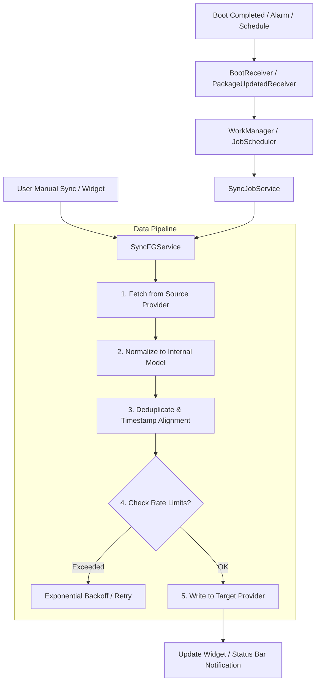

# Health Sync APK Architecture & Engineering Deep Dive

Dokumen ini memaparkan arsitektur sistem, rancangan konkurensi latar belakang, pustaka bawaan, dan strategi integrasi multi-platform berdasarkan hasil rekayasa balik (*reverse engineering*) terhadap paket APK `health-sync-7-9-2-8.apk` (`nl.appyhapps.healthsync`).

---

## 1. Ringkasan Teknis Binary

| Atribut | Nilai Teramati |
|---|---|
| **Package Name** | `nl.appyhapps.healthsync` |
| **Versi Aplikasi** | `7.9.2.8` (Version Code: `1224`) |
| **Min SDK** | `24` (Android 7.0 Nougat) |
| **Target SDK** | `37` (Android 15+ / Latest Android Target) |
| **DEX Count** | 3 (`classes.dex`, `classes2.dex`, `classes3.dex`) |
| **Total Simbol String** | 73.644 string terindeks |
| **Total Kelas Aplikasi** | 121 kelas domain `nl.appyhapps.healthsync` |
| **Arsitektur Native** | `arm64-v8a`, `armeabi-v7a`, `x86`, `x86_64` |

---

## 2. Arsitektur Native Libraries (`lib/`)

Aplikasi mengemas 3 pustaka native (.so) yang dikompilasi untuk 4 arsitektur CPU:

```
lib/
├── arm64-v8a/
├── armeabi-v7a/
├── x86/
└── x86_64/
    ├── libandroidx.graphics.path.so       # Interpolasi grafis kurva UI & lintasan jalur GPS
    ├── libdatastore_shared_counter.so     # Koordinasi konkurensi multi-proses Android Jetpack DataStore
    └── libzstd-jni-1.5.7-13.so            # Kompresi Zstandard kecepatan tinggi untuk payload sinkronisasi
```

### Analisis Fungsi:
1. **`libzstd-jni-1.5.7-13.so`**: Digunakan untuk mengompresi payload riwayat GPS yang sangat besar (jutaan titik trackpoint, detak jantung per detik) sebelum dikirimkan ke cloud atau disimpan di penyimpanan lokal, menghemat bandwidth seluler dan memori secara drastis.
2. **`libdatastore_shared_counter.so`**: Menjamin konsistensi state sinkronisasi ketika foreground service (`SyncFGService`), job scheduler (`SyncJobService`), dan UI berjalan pada proses yang berbeda.

---

## 3. Desain Eksekusi Sinkronisasi Latar Belakang (Sync Lifecycle)



### Komponen Utama:
1. **`SyncFGService`**:
   - Dideklarasikan dengan `android:foregroundServiceType="0x00000001"` (`dataSync`).
   - Wajib di Android 14+ untuk sinkronisasi jangka panjang agar sistem operasi tidak memutus proses secara mendadak saat perangkat sleep.
2. **`SyncJobService`**:
   - Memegang perizinan `android.permission.BIND_JOB_SERVICE`.
   - Mengatur jadwal otomatis (misal setiap jam atau 3 jam sekali) sesuai ketersediaan jaringan (`NetworkStateProxy`) dan status baterai (`BatteryNotLowProxy`).
3. **`HealthSyncWidget`**:
   - Memungkinkan pengguna memicu sinkronisasi cepat langsung dari homescreen Android tanpa harus membuka antarmuka utama.

---

## 4. Pola Integrasi Multi-Platform & OAuth Relay

Health Sync menghubungkan lebih dari 25 ekosistem kesehatan. Berdasarkan analisis string dan manifes, terdapat dua pola integrasi:

### Pola A: Direct Client SDK (On-Device)
Digunakan untuk platform yang menyediakan SDK lokal di Android:
- **Health Connect**: `androidx.health.connect.client` dan `android.health.connect.HealthConnectManager`
- **Samsung Health**: `com.samsung.android.sdk.healthdata.*` (HealthDataResolver)
- **Huawei Health**: `com.huawei.hms.hihealth.*` (HiHealthKit)
- **Google Fit**: Google Play Services Fitness API

### Pola B: Cloud OAuth 2.0 & Token Relay
Platform berbasis web API (Garmin, Strava, Oura, Withings, Intervals, Coros, dll.) menggunakan server perantara aman milik Health Sync:
- `https://server.healthsync.app`
- `https://server3.healthsync.app`

Server ini bertindak sebagai:
1. **OAuth Redirect Handler**: Menjaga kerahasiaan `Client Secret` dari reverse engineering di sisi client.
2. **Token Refresher**: Memperbarui OAuth token yang kedaluwarsa secara otomatis.
3. **API Rate Limit Guard**: Memantau kuota panggilan API mitra agar akun pengguna tidak terkena suspend akibat rate limiting.

---

## 5. Sistem Billing & Monetisasi Ganda

Hasil analisis pada `classes.dex` dan `AndroidManifest.xml` menunjukkan Health Sync mengintegrasikan dua saluran pembayaran:

1. **Google Play In-App Billing (`com.android.billingclient.api`)**:
   - Dikelola oleh `ProxyBillingActivity` dan `ProxyBillingActivityV2`.
   - Untuk langganan atau pembelian lisensi satu kali via akun Google.
2. **Stripe SDK (`com.stripe.android.*`)**:
   - Dikelola oleh `StripeCheckoutActivity`, `PaymentSheetActivity`, dan `CustomerSheetActivity`.
   - Mendukung pembayaran kartu kredit internasional, SEPA direct debit, BACS, dan Financial Connections.
   - Menggunakan `AttestationActivity` untuk memverifikasi integritas perangkat sebelum memproses transaksi kartu.
